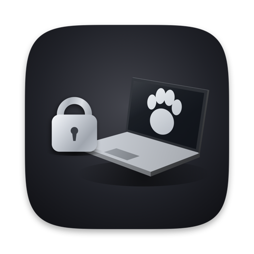
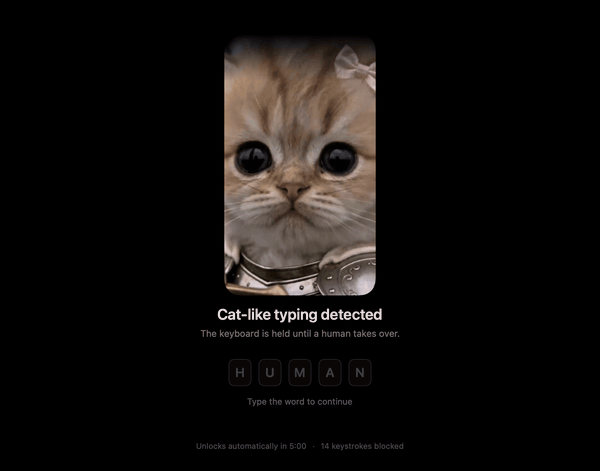
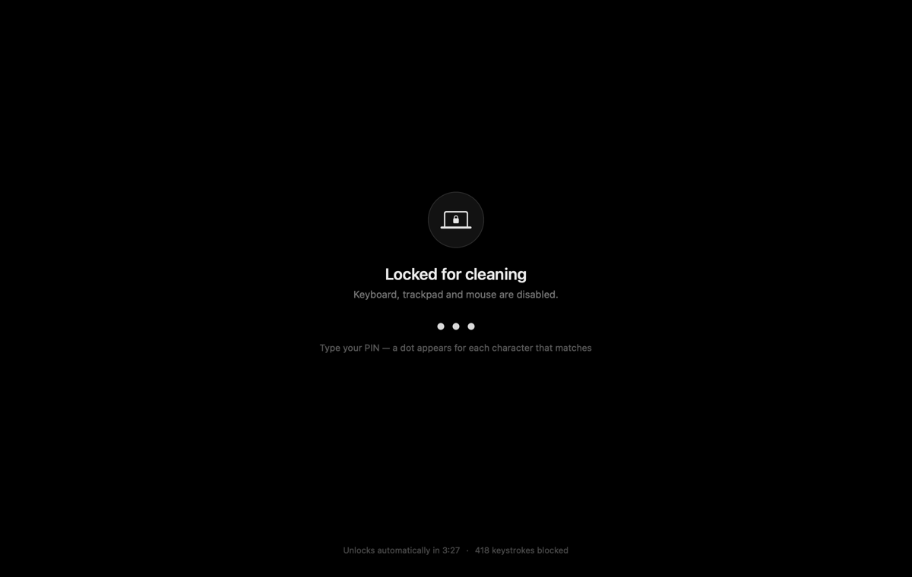

# LidLock

Lock the screen, keyboard, trackpad and mouse while you wipe your MacBook, then
type a PIN to get everything back. It also locks itself when a cat walks across
the keys.



Turn on **Watch for Cats** and LidLock locks the moment it sees a paw: several
neighbouring keys held together, or a few keys pinned for a second and a half
while a cat settles its weight onto the board. It reads only key positions and
timings — never what you type, and nothing is recorded. Type **human** to take
back over.

The reason it exists, though, is the cloth in your hand:



Type your PIN whenever you are done — only the last digits count, so the
hundreds of keypresses your cloth produces never need clearing. A dot appears
for each digit that matches, and nothing on screen gives away how long the PIN
is.

## Install

Download the signed, notarized build from
[Releases](https://github.com/selimmidikoglu/LidLock/releases/latest), unzip it
and drag it to Applications. Or build it from source in one command:

```sh
curl -fsSL https://raw.githubusercontent.com/selimmidikoglu/LidLock/main/install.sh | bash
```

Needs macOS 14+, and the Xcode command line tools if you build it yourself.

## First run

1. Launch it — Settings opens because no PIN is set.
2. Choose a PIN of 4–12 digits.
3. Grant **System Settings › Privacy & Security › Accessibility**.
4. Menu bar icon → **Lock for Cleaning**, or press **⌃⌥⌘L** from anywhere.

Locked out? Hold the power button for ten seconds, or wait for the auto-unlock
timer — five minutes by default.

---

[How it works, in detail](docs/internals.md) · MIT licensed
